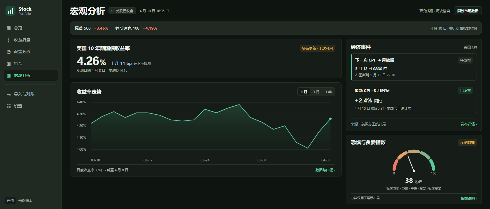
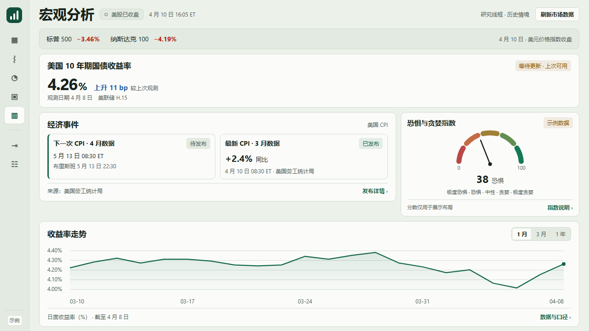

# Layout research for Macro Analysis

Date: 2026-11-26

Direction: [D04 U.S. Market Indicators](../README.md) · Work: [Layout research #63](https://github.com/JasonCodeMaker/Stack-Portfolio/issues/63)

## Recommendation

Add **Macro Analysis** (`宏观分析` / `宏觀分析`) directly below **Holdings**, as the last item in the analysis group above **Imports and reconciliation**. Open on a compact market snapshot. Give the latest available **10-year U.S. Treasury yield** the primary number, put **CPI releases** alongside it on ultrawide screens, and include the recent yield trend. Place a familiar 0–100 Fear & Greed gauge in the sentiment card. A narrow window shows the yield, CPI and sentiment card before the trend. A compact row of S&P 500 and Nasdaq-100 closes can orient the reader when an appropriate market-data route has been verified.

The page answers three questions in order. Is the U.S. equity session open or closed? Which observations are available and what changed? When is the next CPI release? The Researcher confirmed the page name and placement below Holdings, requested the gauge, and specified that details stay in the app. This builds on the accepted indicator ranking. [Candidate screening](indicator-screening.md) · [Current navigation](../../../../desktop/ui/Shell.jsx)

## Why a separate page fits Stock Portfolio

The sidebar currently lists Overview, Performance Review, Allocation, and Holdings, followed by Imports and Settings. Overview starts with account valuation and helps the reader distinguish contributions from investment gains. Performance Review carries an account scope and a valuation date, and compares portfolio performance with AUD total-return benchmarks. A market page starts from the U.S. session and public series, with its own dates, units, and refresh state. The placement below Holdings keeps Macro Analysis in the analysis group, above the divider for maintenance. Every market action opens details in the app, with publisher names shown as attribution. [Existing shell](../../../../desktop/ui/Shell.jsx) · [Current app navigation and analysis controls](../../../../desktop/ui/App.jsx) · [Benchmark methodology](../../../../docs/adr/0002-portfolio-benchmark-returns.md)

An Overview card would reduce navigation by one click, while competing with the amount and data coverage the user uses for a daily account check. A section in Performance Review would put market context beside a historical portfolio comparison, while inheriting a date and account context that cannot determine the current CPI or Treasury reading. A dedicated page can use the existing app shell, localized page title, sidebar and detail pattern, then keep its header tied to the U.S. market and its chart range local. [Overview product decisions](../../D02-portfolio-overview-priorities/research/product-decisions.md) · [Existing app layout](../../../../desktop/ui/layout.js)

## Compare the layouts

| Layout | What the user sees first | Fit for the first release |
| --- | --- | --- |
| **A. Market snapshot with a release panel** | Trading-session state and recent equity moves, followed by the current yield reading and upcoming or latest CPI. The yield trend follows the summary. | Best fit. It surfaces both data clocks without a click, works with two first-release indicators, and uses the existing wide and compact shell patterns. |
| **B. Indicator list with a selected detail** | A navigable list of measures beside the selected chart or data detail. | Useful as the number of indicators grows. With two asymmetric indicators, the selection hides either the CPI event or the yield reading while the user studies the other. |
| **C. Calendar-led view** | Upcoming and recent releases in date order, with market conditions in a secondary summary. | Strong on release days. On the rest of the month it makes the recurring yield question secondary. Use the chronology inside the CPI panel. |

The external precedents inform the comparison. TradingView's U.S. page opens with major indices and exposes an economic calendar separately. Fidelity's market research help defines an index move with its own date and time. Koyfin separates current market dashboards from economic calendars, which reinforces the different update cadences. Apple Stocks illustrates the list-and-detail alternative, where selecting an item exposes its chart. These sources show product patterns. The ranking applies those patterns to the project's first-release scope. [TradingView U.S. markets](https://www.tradingview.com/markets/usa/) · [TradingView calendar](https://www.tradingview.com/economic-calendar/) · [Fidelity market research help](https://www.fidelity.com/webcontent/ap010098-etf-content/19.11.0/help/research/learn_er_markets_sectors_news_analysis.shtml) · [Koyfin market dashboards](https://www.koyfin.com/features/market-dashboards/) · [Apple Stocks guide](https://support.apple.com/en-mk/guide/stocks/welcome/mac)

## Layout A in the existing shell

| Region | Content and reading order |
| --- | --- |
| **Header** | Page title, U.S. equity session state such as **Market closed**, a clock with ET identified, and a market-only refresh action. Keep the session state separate from whether a source has refreshed. The header uses the market clock where the portfolio pages show account and valuation-date controls. |
| **Equity context** | Optional compact row for S&P 500 and Nasdaq-100. A price-index close shows its own date and percent move from the previous valid close. Group the date only when both observations share it. Before an eligible market-data route exists, give the headline space to the session and rates. If the app exposes an existing total-return series in another view, keep its return basis explicit. |
| **10-year Treasury** | Show the latest available yield in percent, the signed change in bp from the preceding valid Treasury observation, the observation date, source, and freshness. Give rates a neutral emphasis since a higher yield can have different implications for different users. If the comparison observation is missing, show the level and date while labelling the change unavailable. |
| **CPI events** | Show the next scheduled release and the latest published result. Each item identifies the reference month and the release date. Use ET for the event and the local equivalent where helpful, especially if the date rolls over. The latest result begins with headline CPI year-over-year. An in-app release detail shows the published value, the measurement period, the release time and the publisher. |
| **Yield trend and details** | Default to one month, with three months and one year when data support them. Use one percent axis, mark the date of the last observation, and leave a gap where a scheduled observation is missing. Offer keyboard-accessible dated values and a data/source detail view. A shorter-history chart only exposes supported ranges. |
| **Market sentiment** | Show a five-band semicircular 0–100 gauge with the score and sentiment as text. Open methodology and data availability in the app. The score 38 in the wireframes is illustrative. Bind current values only after a supported source, observation timestamps, and display and cache rights are verified. Until then the production design uses a neutral **Data unavailable** state with no score or needle. |

**21:9.** Use the current shell's two-column pattern with a chart-led column of roughly two thirds and a narrower column for CPI above sentiment. Keep a reasonable width for the chart and event text. **16:9 and constrained width.** Read rates, CPI and sentiment, then trend. CPI and sentiment can share a row when the content area fits them. The next and last CPI events may also sit beside one another inside their card. A smaller window can stack the events inside their card. Size the view in renderer CSS pixels so display scaling and the docked detail inspector can trigger the compact arrangement. The existing compact icon rail and fixed header provide the precedent. [Shell grid and detail component](../../../../desktop/ui/Shell.jsx) · [Shell size rules](../../../../desktop/ui/layout.js) · [Project layout targets](../../../../docs/investment-dashboard-design.md)

### 21:9 wireframe, dark theme

### 16:9 wireframe, light theme

Both sketches use the same historical April 10, 2025 scenario. The equity moves use the historical close, and the wireframe assumes those closes were received. The Treasury panel shows an earlier observation still available in the chosen H.15 scenario. The BLS release at 08:30 ET was for March. The April report was scheduled for May 13. Numeric chart values through April 8 come from DGS10. The sentiment score and bands illustrate the gauge independently of the historical session. Detail controls represent in-app panels in these static sketches. [Historical session and clock audit](historical-session-comparison.md) · [BLS April 10 release and next date](https://www.bls.gov/news.release/archives/cpi_04102025.htm) · [DGS10](https://fred.stlouisfed.org/series/DGS10)

## State and accessibility

| Situation | Use in the interface |
| --- | --- |
| Market closed and rate pending | Keep **Market closed** in the header. Beside the rate show **Awaiting update · Last available** and the actual observation date. The plotted line ends on that observation. |
| Scheduled closure or no observation expected | Identify the affected source and date. Keep the previous result's date beside its value. Distinguish a market holiday from a delayed feed. |
| Refresh fails with cached data | Keep dated cached content visible. Show the refresh failure inline at the affected card and allow retry at the page header. Another source can update independently. |
| No usable observation | Put **Data unavailable** in the affected card with source or retry information. Keep the other cards and release dates readable. |
| CPI time scheduled, results pending, or data released | An upcoming event shows the reference month and the scheduled time. At or after release time, use **Awaiting data** until the official result arrives. Once confirmed, show the year-over-year value and the actual publication time. |

Match the app's green accent, light and dark surfaces, sidebar selection, typography, number alignment and gutters. Pair signed changes and freshness colors with visible text. Provide a visible keyboard focus, use hover as an extra path to chart details, and expose the same dates and values through keyboard interaction or a compact table. Keep focus visible when opening and closing the detail. Announce a completed manual refresh and exceptions in a polite status region without moving focus or announcing each background poll. [Design system tokens](../../../../desktop/ui/design.css) · [Existing quote status wording](../../../../desktop/ui/MarketQuotes.jsx) · [WCAG 2.2](https://www.w3.org/TR/WCAG22/)

## What to validate before implementation

Use the same scenario and content when comparing Layout A with the list-first layout. Ask participants to locate Macro Analysis below Holdings from Overview, identify the date and change of the latest rate, identify the next CPI reference month and release time, and open both the CPI details and sentiment explanation without leaving the app. Add a case in which the market is closed for a holiday and a refresh fails with a cached rate. Check correct first answers, time to answer, first click and serious source-date errors. Repeat in 16:9 and 21:9, with keyboard-only use and the existing zoom ranges. The two static layouts were inspected at 1280×720 in light mode and 1680×720 in dark mode. Actual Electron interaction and user comprehension remain for validation.

The daily-rate source still needs qualification over several release windows. A candidate equity strip depends on verified data access and display rights. The wireframes show the full in-app layout. Continuous availability and authorization for the CNN score remain open. [Indicator source and permissions audit](source-and-permissions-audit.md)
