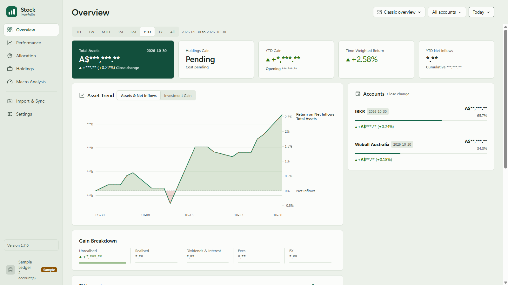
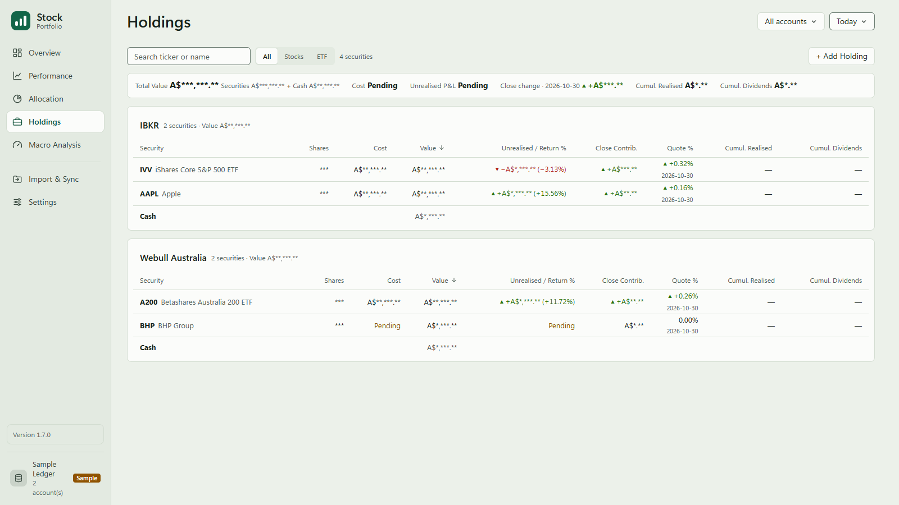
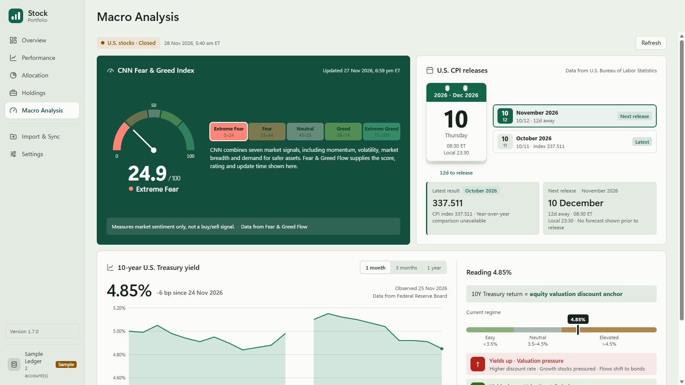
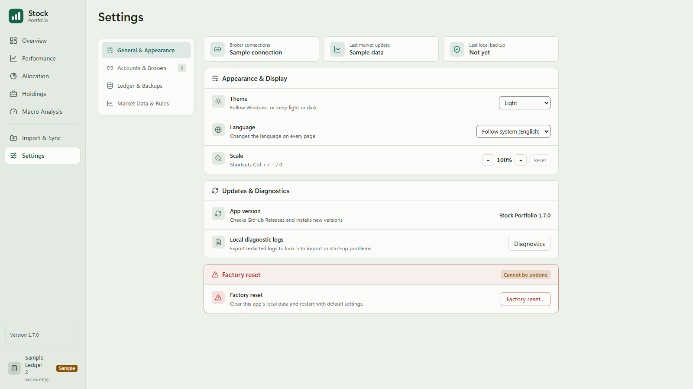
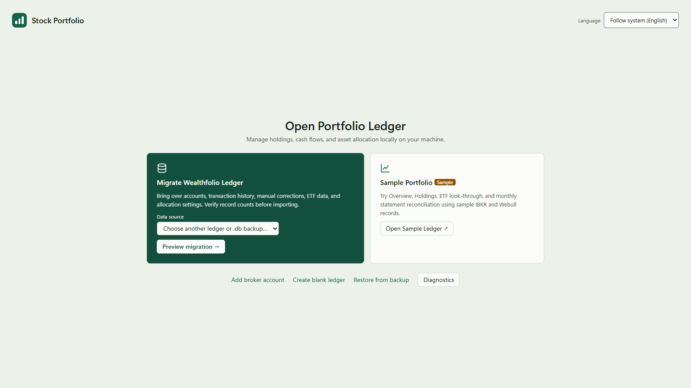

<div align="center">

# Stock Portfolio

**A local, private portfolio manager for Windows**

**English** · [简体中文](README.zh-CN.md)

[](https://github.com/JasonCodeMaker/Stock-Portfolio/releases)


[Download](https://github.com/JasonCodeMaker/Stock-Portfolio/releases) ·
[Highlights](#highlights) ·
[Panels](#panels) ·
[Broker support](#broker-support) ·
[Getting started](#getting-started)

<br />



</div>

---

## About

This is my personal project for tracking and managing my investment portfolio. I hold stocks and ETFs with both **Interactive Brokers (IBKR)** and **Webull Australia**, and I wanted one place to answer a few simple questions:

- How much are both accounts worth together, and how much did I gain today and this year?
- How does my return compare with the S&P 500 and NASDAQ-100?
- After looking through my ETFs, which companies is my money actually in?
- Do my local records match the broker statements?
- What is the current U.S. macro backdrop — market sentiment, 10-year Treasury yield, and CPI inflation?

> [!NOTE]
> It currently supports **IBKR and Webull Australia only** on **Windows (x64)**, and values everything in Australian dollars (**AUD**). If you have the same setup, feel free to download and use it.

---

## Highlights

| | | |
| :-: | :--- | :--- |
| 🔒 | **Your data stays on your PC** | The ledger is an encrypted local file. No cloud account, no uploaded holdings. |
| 🏦 | **Both brokers in one view** | Holdings, cash, and activity are converted to AUD at the same date and FX rate, then combined. |
| 🔍 | **ETF look-through** | ETFs are broken down into their underlying companies and merged with your direct holdings to show real company exposure. |
| ✅ | **Preview before saving** | Broker sync lists every change before writing anything, and you can reconcile against monthly statements line by line. |
| 📊 | **U.S. macro indicators** | CNN Fear & Greed sentiment, 10-year Treasury yields, and the U.S. CPI release calendar alongside your portfolio. |

---

## Panels

### Overview

Total assets, daily change, period investment gain, time-weighted return, and net contribution, with an asset trend chart and a per-account breakdown. Two layouts are available: **Classic** (shown above) and **Daily**.


### Performance

Compare your return with benchmarks like the S&P 500 and NASDAQ-100. Check return gap, max drawdown, the longest underperformance period, and each holding's contribution. Drag to select any range and recalculate, and jot down review notes along the way.


### Allocation

A treemap of your company exposure after looking through ETFs, with tail exploration for smaller holdings. Set target weights for ETFs, individual stocks, and cash, and see how far you have drifted.


### Holdings

Shares, cost basis, market value, unrealised gain, and daily contribution for every security in each account, plus cumulative realised gains and dividends.



### Macro Analysis

Check the U.S. equity session and Eastern Time alongside the CNN Fear & Greed sentiment gauge, the U.S. CPI release calendar (showing both the latest result and next scheduled release), and an interactive 10-year U.S. Treasury yield chart (`1M` / `3M` / `1Y`) with equity-impact context.



### Import & Sync

Pick an account on the left and work on it on the right, or press **Update all accounts** to sync every connected broker at once. Every change is listed in a table before anything is saved. From the same workspace you can import a statement file, record a trade or cash movement, reconcile cash, holdings, and net value against a broker statement, set opening balances, and add or delete accounts.


### Settings

Four categories: **General & Appearance**, **Accounts & Brokers**, **Ledger & Backups**, and **Market Data & Rules**. A status strip at the top shows broker connections, the last market update, and the last local backup.



---

## Broker support

| Source | Online sync | File import | Statement check | Guide |
| :--- | :--- | :--- | :---: | :--- |
| **Interactive Brokers (IBKR)** | Activity Flex API (last 365 days) | Flex XML | ✓ | [IBKR setup guide](docs/onboarding/ibkr.md) |
| **Webull Australia** | OpenAPI (last 6 months) | Execution CSV | ✓ | [Webull AU setup guide](docs/onboarding/webull-au.md) |
| **Manual / Migration** | — | Wealthfolio SQLite / Manual entry | ✓ | [Detailed guide (中文)](desktop/README.md) |

---

## Getting started

1. Download `Stock-Portfolio-Setup-<version>-x64.exe` from [Releases](https://github.com/JasonCodeMaker/Stock-Portfolio/releases) and install it.
2. Open the app and pick one of these:
   - **Sample Portfolio** — try every feature with made-up data first.
   - **Add broker account** — connect IBKR or Webull Australia by following the step-by-step guide in the app.
   - **Migrate Wealthfolio Ledger** — if you used Wealthfolio before, bring your history across.
3. The interface is available in English, Simplified Chinese, and Traditional Chinese.

> [!TIP]
> It's a good idea to create a password-protected `.spbackup` copy in **Settings → Ledger & Backups → Back up ledger** so you can restore your data if you ever reinstall Windows or switch PCs.

<details>
<summary>Preview the Welcome screen</summary>

<br />



</details>

---

## Data and privacy

- **Local ledger**: stored in `%APPDATA%\Stack Portfolio\` and encrypted with SQLCipher. The key is protected by your Windows user account.
- **Broker credentials**: get an extra layer of Windows encryption.
- **Prices, FX & macro data**: prices and FX rates come from public Yahoo Finance and FRED endpoints (requests contain only tickers and dates, and automatic updates can be turned off in Settings); Macro Analysis fetches public data from the Federal Reserve Board (10-year Treasury yield), U.S. Bureau of Labor Statistics (CPI & release schedule), and the free Fear & Greed Flow feed. No API key is needed, and macro readings are cached locally.
- **Backups**: export a password-encrypted `.spbackup` file anytime.

---

## Build from source

<details>
<summary>Want to run or build it yourself? (Node.js ≥ 22.15, Windows x64)</summary>

Built with Electron, React 19, TypeScript, SQLCipher (`better-sqlite3-multiple-ciphers`), and D3.

```bash
cd desktop
npm ci --ignore-scripts   # uses bundled SQLCipher prebuilds
npm start                 # build and launch the app
```

Other scripts:

```bash
npm run typecheck         # TypeScript type check
npm test                  # build and run tests
npm run dist              # build Windows x64 installer -> release/desktop/
```

</details>

---

## Disclaimer

This project is for personal record keeping and analysis only and is not investment advice. Valuations and returns depend on broker data and public market data; your broker statements are the authoritative record.
