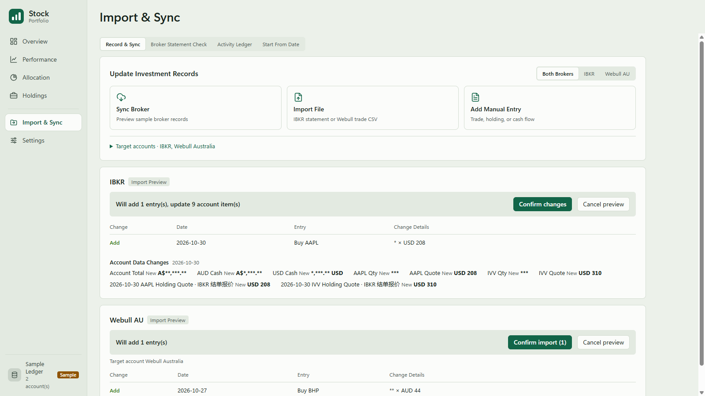

# Stock Portfolio

**A local, private portfolio manager for Windows**

**English** · [简体中文](README.zh-CN.md)

[Download](https://github.com/JasonCodeMaker/Stack-Portfolio/releases) ·
[IBKR setup guide](docs/onboarding/ibkr.md) ·
[Webull AU setup guide](docs/onboarding/webull-au.md)

## About

This is my personal project for tracking and managing my investment portfolio. I hold stocks and ETFs with both **Interactive Brokers (IBKR)** and **Webull Australia**, and I wanted one place to answer:

- How much are both accounts worth together, and how much did I gain today and this year?
- How does my return compare with the S&P 500 and NASDAQ-100?
- After looking through my ETFs, which companies is my money actually in?
- Do my local records match the broker statements?

It currently supports **IBKR and Webull Australia only**, and values everything in Australian dollars (AUD). If you have the same needs, feel free to download and use it.

## Highlights

- **Your data stays on your PC**: the ledger is an encrypted local file. No cloud account, no uploaded holdings.
- **Both brokers in one view**: holdings, cash and activity are converted to AUD at the same date and FX rate, then combined.
- **ETF look-through**: ETFs are broken down into their underlying companies and merged with your direct holdings to show real exposure.
- **Preview before saving**: broker sync lists every change before it is written, and you can reconcile against monthly statements line by line.

## Panels

### Overview

Total assets, daily change, period gain, time-weighted return and net inflows, with an asset trend chart and a per-account breakdown. Two layouts are available: *Classic* and *Daily*.

### Performance

Compare your return with benchmarks such as the S&P 500 and NASDAQ-100. See max drawdown, the longest lagging period, and each holding's contribution. Drag to select any range and recalculate, and keep review notes.

### Allocation

A treemap of your exposure to each company after looking through ETFs. Set target weights for ETFs, individual stocks and cash, and see how far you have drifted.

### Holdings

Shares, cost, market value, unrealised gain and daily contribution for every security in each account, plus cumulative realised gains and dividends.

### Import & Sync

Sync a broker or import a statement file, review the changes, then confirm. Check cash, positions and net value against a broker statement, or add a trade or cash flow by hand.

## Getting started

1. Download `Stock-Portfolio-Setup-<version>-x64.exe` from [Releases](https://github.com/JasonCodeMaker/Stack-Portfolio/releases) and install it.
2. Open the app and choose one of these:
   - **Sample Portfolio**: try every feature with made-up data first.
   - **Add broker account**: connect IBKR or Webull Australia by following the step-by-step guide in the app.
   - **Migrate Wealthfolio Ledger**: if you used Wealthfolio before, bring your history across.
3. We recommend creating a password-protected backup in **Settings → Ledger → Back up ledger**.

The interface is available in English, Simplified Chinese and Traditional Chinese.

## Data and privacy

- The ledger is stored in `%APPDATA%\Stack Portfolio\` and encrypted with SQLCipher. The key is protected by your Windows user account.
- Broker credentials get an extra layer of Windows encryption.
- Prices and FX rates come from the public Yahoo Finance and FRED endpoints. No API key is needed, and requests contain only tickers and dates. You can turn automatic updates off in Settings.

## Disclaimer

This project is for personal record keeping and analysis only and is not investment advice. Valuations and returns depend on broker data and public market data; your broker statements are the authoritative record.
