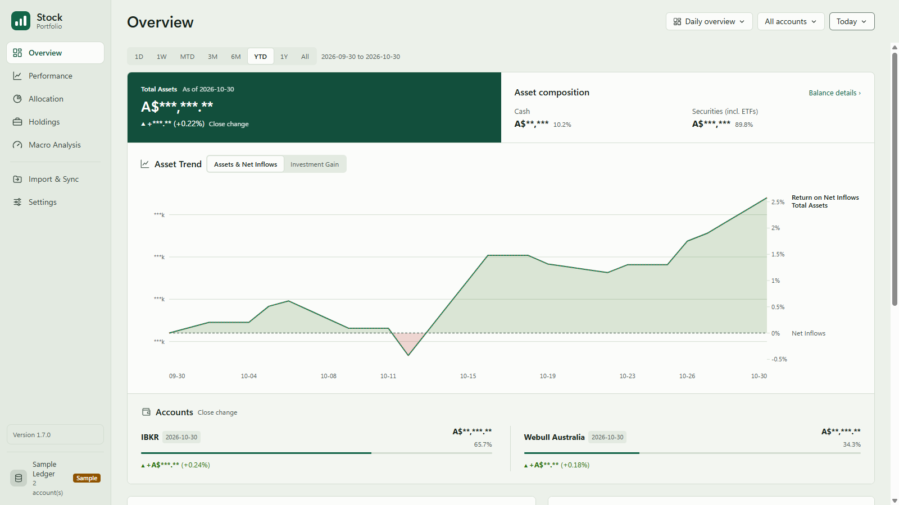
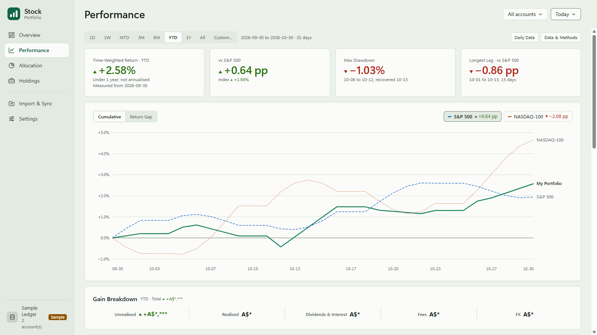
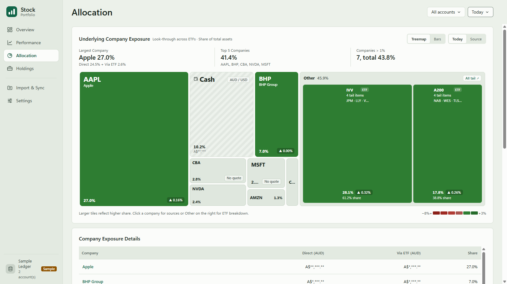

<div align="center">

# Stock Portfolio

**A local-first, encrypted portfolio manager for Windows — built for IBKR & Webull Australia.**

**English** · [简体中文](README.zh-CN.md)

[](https://github.com/JasonCodeMaker/Stack-Portfolio/releases)


[Download](https://github.com/JasonCodeMaker/Stack-Portfolio/releases) ·
[Features](#features) ·
[Broker Support](#broker-support) ·
[Getting Started](#getting-started) ·
[Privacy](#data--privacy)

<br />


</div>

---

## Why Stock Portfolio?

Managing stocks and ETFs across multiple brokers makes basic portfolio questions surprisingly hard to answer. **Stock Portfolio** brings your **Interactive Brokers (IBKR)** and **Webull Australia** accounts into a single encrypted desktop ledger so you can see:

- **Unified valuation & P&L** — what both accounts are worth together in AUD, and how much you gained today and over any review period.
- **Benchmark comparison** — how your time-weighted return compares against the S&P 500 and NASDAQ-100.
- **True company exposure** — which underlying companies your money is actually in after looking through ETFs.
- **Verifiable records** — whether your local ledger matches your monthly broker statements line by line.

> [!NOTE]
> Stock Portfolio currently supports **IBKR** and **Webull Australia** on **Windows (x64)**, with portfolio valuations reported in **AUD**. The interface is available in English, Simplified Chinese, and Traditional Chinese.

---

## Features

| | Capability | Details |
| :-: | :--- | :--- |
| 🔒 | **Local-First & Encrypted** | Your ledger lives in an encrypted SQLCipher database on your PC — no cloud account, no telemetry, no uploaded holdings. |
| 🏦 | **Unified Multi-Broker View** | Combines IBKR and Webull Australia holdings, cash, and activity in AUD using consistent valuation-date exchange rates. |
| 🔍 | **ETF Look-Through** | Breaks ETFs down into their underlying companies and merges them with direct security holdings to show real company exposure. |
| ✅ | **Preview-First Sync** | Reviews every proposed change before writing to your ledger, with built-in statement reconciliation. |

---

## Interface Tour

### Overview

Track total portfolio value, daily change, period investment gain, time-weighted return, and net contribution alongside an asset trend chart and per-account breakdown. Switch between **Classic** (shown above) and **Daily** layouts.



### Performance

Compare your time-weighted return against benchmarks such as the **S&P 500** and **NASDAQ-100**. Inspect return gap, max drawdown, longest underperformance period, and each holding's AUD contribution. Drag across the chart to recalculate any custom range and save review notes.



### Allocation

Explore a treemap of your true **company exposure** after looking through ETFs. Set target weights across ETFs, individual stocks, and cash, and monitor drift over time.



### Holdings

Inspect shares, cost basis, market value, unrealised gain, and daily contribution for every security in each account, along with cumulative realised gains and dividends.


### Import, Sync & Reconciliation

Sync directly from your broker or import statement files, preview the exact diff before confirming, reconcile cash, positions, and net asset value against broker statements, or log trades and external flows manually.


---

## Broker Support

| Source | Online Sync | File Import | Statement Reconciliation | Setup Guide |
| :--- | :--- | :--- | :---: | :--- |
| **Interactive Brokers (IBKR)** | Activity Flex API (last 365 days) | Flex XML | ✓ | [IBKR Guide](docs/onboarding/ibkr.md) |
| **Webull Australia** | OpenAPI (last 6 months) | Execution CSV | ✓ | [Webull AU Guide](docs/onboarding/webull-au.md) |
| **Manual / Migration** | — | Wealthfolio SQLite / Manual entry | ✓ | [Detailed Guide (中文)](desktop/README.md) |

---

## Getting Started

1. **Download & install** `Stock-Portfolio-Setup-<version>-x64.exe` from [GitHub Releases](https://github.com/JasonCodeMaker/Stack-Portfolio/releases).
2. **Launch the app** and pick how you want to start:
   - **Sample Portfolio** — explore every panel with built-in sample data first.
   - **Add Broker Account** — connect IBKR or Webull Australia using the step-by-step guides.
   - **Migrate Wealthfolio Ledger** — import your existing Wealthfolio history into a local encrypted ledger.
3. **Create a backup** once your accounts are set up.

> [!TIP]
> Create a password-protected `.spbackup` archive via **Settings → Ledger → Back up ledger** so you can restore your portfolio after reinstalling Windows or switching PCs.

<details>
<summary>Preview the Welcome screen</summary>

<br />


</details>

---

## Data & Privacy

| Layer | How it works |
| :--- | :--- |
| **Local Ledger** | Stored in `%APPDATA%\Stack Portfolio\` and encrypted with SQLCipher (256-bit key protected by your Windows user account). |
| **Broker Credentials** | Encrypted with an additional layer of Windows user-account protection. |
| **Market Data & FX** | Fetched from public Yahoo Finance and FRED endpoints — no API key required, and requests contain only tickers and dates. Automatic updates can be disabled in Settings. |
| **Backups** | Export standalone, password-protected `.spbackup` files at any time. |

---

## Build from Source

<details>
<summary>Developer setup & build commands (Node.js ≥ 22.15, Windows x64)</summary>

Built with **Electron**, **React 19**, **TypeScript**, **SQLCipher** (`better-sqlite3-multiple-ciphers`), and **D3**.

```bash
cd desktop
npm ci --ignore-scripts   # uses bundled SQLCipher prebuilds
npm start                 # build and launch Electron app
```

Useful scripts:

```bash
npm run typecheck         # TypeScript type check
npm test                  # build and run unit & UI tests
npm run dist              # build Windows x64 NSIS installer -> release/desktop/
```

</details>

---

## Disclaimer

This project is for personal record keeping and analysis only and does not constitute investment advice. Valuations and returns depend on broker records and public market data; your broker statements are always the authoritative record.
