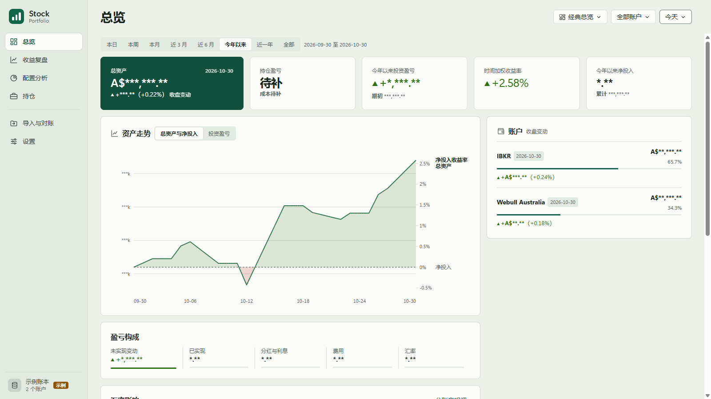
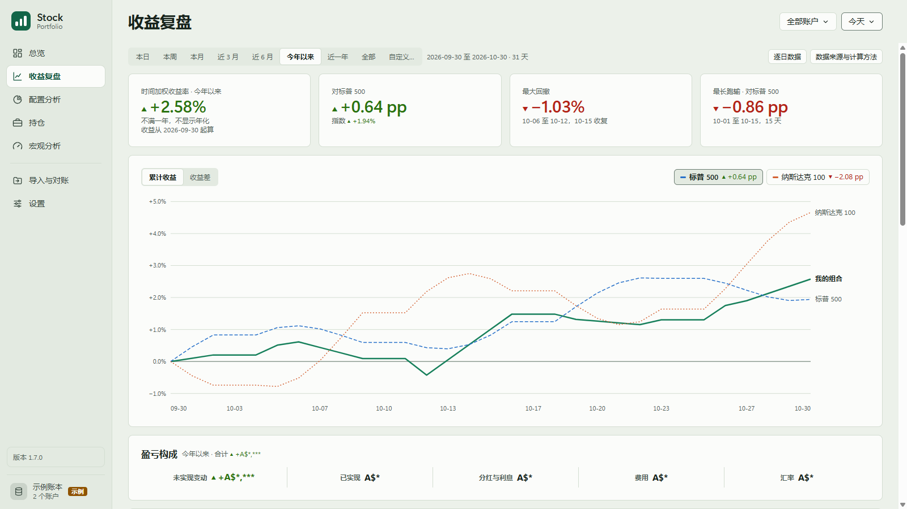
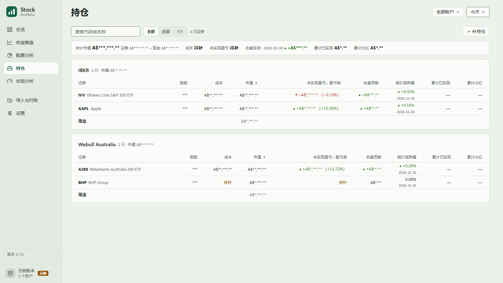
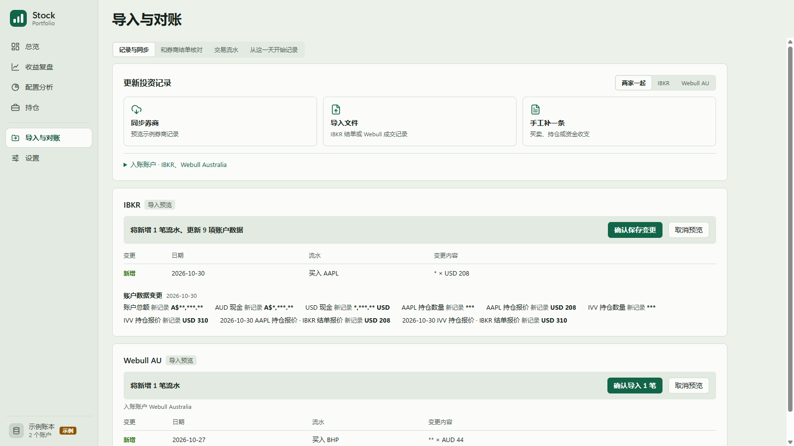

<div align="center">

# Stock Portfolio

**本地优先、端到端加密的 Windows 投资组合管理应用 —— 专为 IBKR 与 Webull Australia 打造。**

[English](README.md) · **简体中文**

[](https://github.com/JasonCodeMaker/Stack-Portfolio/releases)


[下载安装包](https://github.com/JasonCodeMaker/Stack-Portfolio/releases) ·
[核心特性](#核心特性) ·
[券商支持](#券商支持) ·
[快速开始](#快速开始) ·
[数据与隐私](#数据与隐私)

<br />



</div>

---

## 为什么做这个应用？

同时在多家券商持有股票和 ETF 时，连最基本的组合问题都很难一眼看清。**Stock Portfolio** 将你的 **IBKR（盈透证券）** 与 **Webull Australia（微牛澳洲）** 账户汇总到本地加密账本中，帮助你随时回答四个核心问题：

- **合并估值与盈亏** — 两个账户合起来值多少澳元，今天和任意复盘区间赚了多少。
- **基准对比** — 时间加权收益率相比标普 500、纳斯达克 100 跑赢还是跑输。
- **真实公司敞口** — 把持有的 ETF 穿透拆解后，资金实际集中在哪些公司。
- **账目可核对** — 本地记录是否与券商月结单逐项一致。

> [!NOTE]
> 目前支持 **Windows (x64)** 平台下的 **IBKR** 与 **Webull Australia** 账户，组合估值以 **澳元（AUD）** 为基准。界面支持简体中文、繁體中文和 English。

---

## 核心特性

| | 特性 | 说明 |
| :-: | :--- | :--- |
| 🔒 | **本地优先与加密存储** | 账本以 SQLCipher 加密保存在本机，无需云端账户，不上传任何持仓数据。 |
| 🏦 | **多券商统一汇总** | 将 IBKR 与 Webull Australia 的持仓、现金和流水按同一估值日汇率折算为澳元合并计算。 |
| 🔍 | **ETF 穿透分析** | 将 ETF 拆解为底层成分公司，与直接持股合并计算真实的公司敞口与集中度。 |
| ✅ | **先预览、再入账** | 同步券商或导入文件时先展示完整变更预览，确认后再写入，并支持与月结单逐项对账。 |

---

## 功能一览

### 总览

集中展示总资产、当日变动、期间投资盈亏、时间加权收益率和净投入，并附带资产走势与各账户占比。支持在 **经典总览**（见顶部）与 **日常查账** 两种布局间切换。


### 收益复盘

对比 **标普 500**、**纳斯达克 100** 等基准，直观查看收益差、最大回撤、最长跑输区间及各持仓的澳元贡献。支持在图表中拖选任意区间即时重算，并保存复盘笔记。



### 配置分析

通过方框图展示穿透 ETF 后的真实**公司敞口**。可为 ETF、个股和现金设定目标权重，持续跟踪当前偏离度。


### 持仓

按账户展示每只证券的股数、买入成本、市值、未实现盈亏和当日贡献，以及累计已实现收益与分红。



### 导入与对账

一键同步券商或导入结单文件，先预览变更再确认入账；可与券商结单核对现金、持仓与净值差额，也支持手工补录买卖与资金流水。



---

## 券商支持

| 来源 | 在线同步 | 文件导入 | 结单对账 | 使用教程 |
| :--- | :--- | :--- | :---: | :--- |
| **IBKR（盈透证券）** | Activity Flex API（最近 365 天） | Flex XML | ✓ | [IBKR 接入教程](docs/onboarding/ibkr.md) |
| **Webull Australia** | OpenAPI（最近 6 个月） | 成交 CSV | ✓ | [Webull AU 接入教程](docs/onboarding/webull-au.md) |
| **手工记录 / 账本迁移** | — | Wealthfolio SQLite / 手工补录 | ✓ | [详细使用说明](desktop/README.md) |

---

## 快速开始

1. **下载并安装**：从 [GitHub Releases](https://github.com/JasonCodeMaker/Stack-Portfolio/releases) 下载 `Stock-Portfolio-Setup-<版本>-x64.exe` 并安装。
2. **启动应用**，在欢迎页选择适合你的入口：
   - **示例组合** — 使用内置虚构数据先完整体验全部面板。
   - **添加券商账户** — 参照图文教程连接 IBKR 或 Webull Australia。
   - **迁入 Wealthfolio 账本** — 将现有的 Wealthfolio 历史记录迁入本地加密账本。
3. **备份账本**：完成账户配置后，建议立即导出一份加密备份。

> [!TIP]
> 在 **设置 → 账本 → 备份账本** 创建带独立密码的 `.spbackup` 备份文件，重装系统或更换电脑时可直接恢复全部数据。

<details>
<summary>预览欢迎页界面</summary>

<br />


</details>

---

## 数据与隐私

| 层级 | 实现方式 |
| :--- | :--- |
| **本地账本** | 保存在 `%APPDATA%\Stack Portfolio\`，采用 SQLCipher 加密（256 位密钥由当前 Windows 用户账户保护）。 |
| **券商凭据** | 额外叠加一层 Windows 用户级加密存储。 |
| **行情与汇率** | 来自 Yahoo Finance 和 FRED 公开接口，无需 API Key，请求仅包含证券代码与日期；可在设置中关闭自动更新。 |
| **密码备份** | 随时导出独立的 `.spbackup` 密码加密归档。 |

---

## 本地构建

<details>
<summary>开发环境与构建命令（Node.js ≥ 22.15，Windows x64）</summary>

基于 **Electron**、**React 19**、**TypeScript**、**SQLCipher**（`better-sqlite3-multiple-ciphers`）与 **D3** 构建。

```bash
cd desktop
npm ci --ignore-scripts   # 使用随包附带的 SQLCipher 预编译二进制
npm start                 # 构建并启动桌面应用
```

常用命令：

```bash
npm run typecheck         # TypeScript 类型检查
npm test                  # 构建并运行单元测试与界面测试
npm run dist              # 打包 Windows x64 NSIS 安装程序 -> release/desktop/
```

</details>

---

## 免责声明

本项目仅用于个人记录与分析，不构成任何投资建议。估值与收益依赖券商数据与公开行情，请始终以券商结单作为权威依据。
