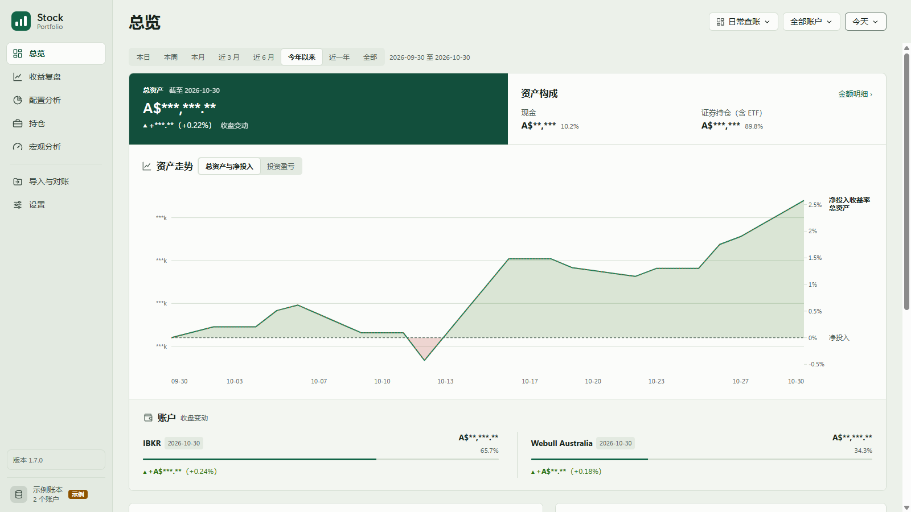
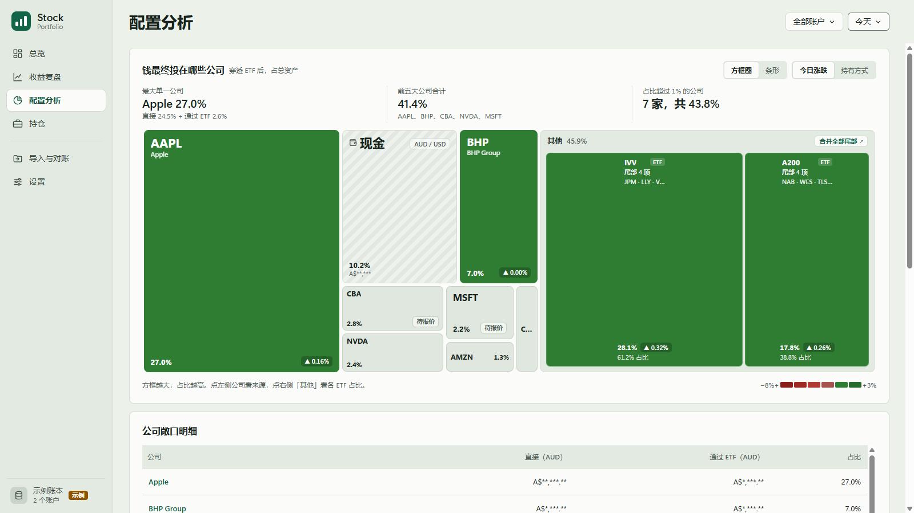
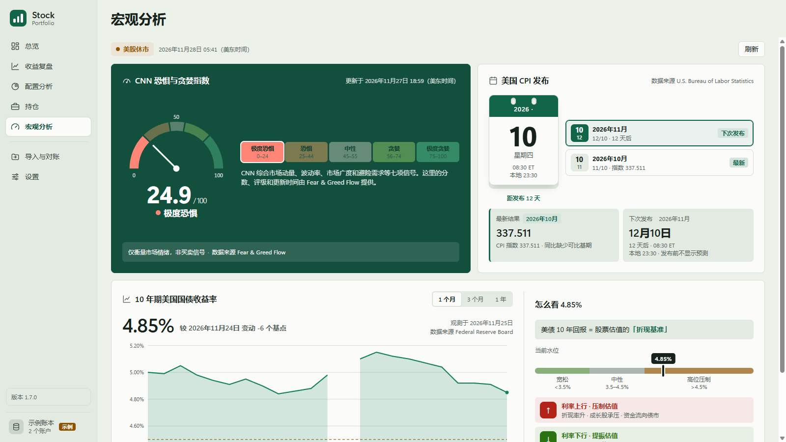

<div align="center">

# Stock Portfolio

**一款本地运行的 Windows 投资组合管理应用**

[English](README.md) · **简体中文**

[](https://github.com/JasonCodeMaker/Stock-Portfolio/releases)


[下载安装包](https://github.com/JasonCodeMaker/Stock-Portfolio/releases) ·
[主要特点](#主要特点) ·
[功能面板](#功能面板) ·
[券商支持](#券商支持) ·
[快速开始](#快速开始)

<br />


</div>

---

## 简介

这是我个人用来监控和管理投资组合的小项目。我同时在 **IBKR（盈透证券）** 和 **Webull Australia（微牛澳洲）** 两家券商持有股票和 ETF，平时总想在一个地方看清楚几件事：

- 两个账户合起来一共有多少钱，今天、今年赚了多少；
- 收益和标普 500、纳斯达克 100 比起来是好是差；
- 买的 ETF 穿透之后，钱实际投在了哪些公司；
- 本地记录和券商结单是否一致；
- 当前美股宏观环境如何——市场情绪、10 年期美债收益率和 CPI 通胀数据怎样？

> [!NOTE]
> 目前**仅支持 IBKR 和 Webull Australia**，运行在 **Windows (x64)** 上，估值以澳元（**AUD**）为准。如果你有相同的需求，欢迎下载试试。

---

## 主要特点

| | | |
| :-: | :--- | :--- |
| 🔒 | **数据只存在本机** | 账本是加密的本地文件，没有云端账户，不上传持仓。 |
| 🏦 | **两家券商合并看** | 持仓、现金和流水按同一日期、同一汇率换算成澳元后汇总。 |
| 🔍 | **ETF 穿透** | 把 ETF 拆到成分公司，与直接持有的个股合并计算真实敞口。 |
| ✅ | **先预览再入账** | 同步券商时先列出变更，确认后才写入，并可与月结单逐项核对。 |
| 📊 | **美股宏观指标** | 同屏查看 CNN 恐惧与贪婪指数、10 年期美债收益率和美国 CPI 发布日历。 |

---

## 功能面板

### 总览

总资产、当日变动、期间投资盈亏、时间加权收益率和净投入，配上资产走势和各账户占比。提供「经典总览」（见顶部）和「日常查账」两种布局。



### 收益复盘

对比标普 500、纳斯达克 100 等基准，查看收益差、最大回撤、最长跑输区间和各持仓的收益贡献。可以拖选任意区间重新计算，顺手记几条复盘笔记。


### 配置分析

方框图展示穿透 ETF 后每家公司的占比，并支持查看较小持仓的尾部成分。可为 ETF、个股和现金设置目标比例，看看当前偏离了多少。



### 持仓

按账户列出每只证券的股数、成本、市值、未实现盈亏和收盘贡献，以及累计已实现收益和分红。


### 宏观分析

查看美股交易状态与美东时间、CNN 恐惧与贪婪指数仪表盘、美国 CPI 发布日历（同屏展示最新结果与下次计划发布时间），以及可交互的 10 年期美国国债收益率走势（`1 个月` / `3 个月` / `1 年`）与股市估值参考。



### 导入与对账

一键同步券商或导入结单文件，先预览变更再确认入账；可以和券商结单比较现金、持仓和净值差额，也可以手工补录买卖或资金收支。


---

## 券商支持

| 来源 | 在线同步 | 文件导入 | 结单核对 | 教程 |
| :--- | :--- | :--- | :---: | :--- |
| **IBKR（盈透证券）** | Activity Flex API（最近 365 天） | Flex XML | ✓ | [IBKR 接入教程](docs/onboarding/ibkr.md) |
| **Webull Australia** | OpenAPI（最近 6 个月） | 成交 CSV | ✓ | [Webull AU 接入教程](docs/onboarding/webull-au.md) |
| **手工记录 / 账本迁入** | — | Wealthfolio SQLite / 手工补录 | ✓ | [详细使用说明](desktop/README.md) |

---

## 快速开始

1. 从 [Releases](https://github.com/JasonCodeMaker/Stock-Portfolio/releases) 下载 `Stock-Portfolio-Setup-<版本>-x64.exe` 并安装。
2. 打开应用，在欢迎页按需要选择：
   - **示例组合** — 用虚构数据先体验全部功能；
   - **添加券商账户** — 按 [IBKR](docs/onboarding/ibkr.md) 或 [Webull AU](docs/onboarding/webull-au.md) 图文教程授权；
   - **迁入 Wealthfolio 账本** — 如果你之前在用 Wealthfolio，可直接迁入历史记录。
3. 界面支持简体中文、繁體中文和 English。

> [!TIP]
> 建议在 **设置 → 账本 → 备份账本** 创建一份带密码的 `.spbackup` 备份，万一以后重装系统或换电脑可以直接恢复。

<details>
<summary>预览欢迎页</summary>

<br />


</details>

---

## 数据与隐私

- **本地账本**：保存在 `%APPDATA%\Stack Portfolio\`，使用 SQLCipher 加密，密钥由当前 Windows 用户保护。
- **券商凭据**：额外经 Windows 加密保存。
- **行情、汇率与宏观数据**：行情与汇率来自 Yahoo Finance 和 FRED 的公开接口，请求只包含证券代码和日期（可在设置中关闭自动更新）；宏观分析读取 Federal Reserve Board（10 年期美债收益率）、美国劳工统计局 BLS（CPI 及发布日历）和免费 Fear & Greed Flow 数据源，均无需 API Key 并本地缓存。
- **密码备份**：随时可以导出一份独立的 `.spbackup` 加密备份。

---

## 本地构建

<details>
<summary>如果想自己跑或打包（Node.js ≥ 22.15，Windows x64）</summary>

使用 Electron、React 19、TypeScript、SQLCipher（`better-sqlite3-multiple-ciphers`）和 D3 构建。

```bash
cd desktop
npm ci --ignore-scripts   # 使用随包附带的 SQLCipher 预编译二进制
npm start                 # 构建并启动应用
```

其他常用命令：

```bash
npm run typecheck         # TypeScript 类型检查
npm test                  # 构建并运行测试
npm run dist              # 打包 Windows x64 安装包 -> release/desktop/
```

</details>

---

## 免责声明

本项目仅用于个人记录与分析，不构成任何投资建议。估值和收益依赖券商数据与公开行情，请以券商结单为准。
