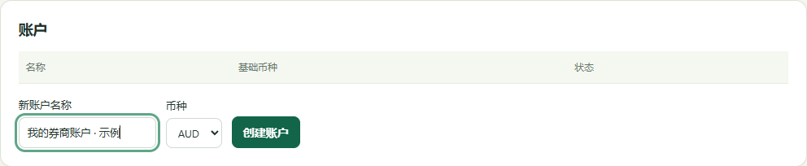
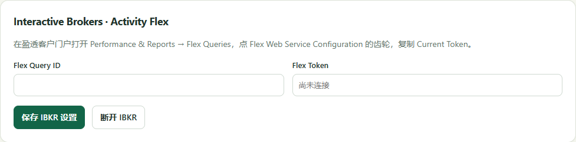
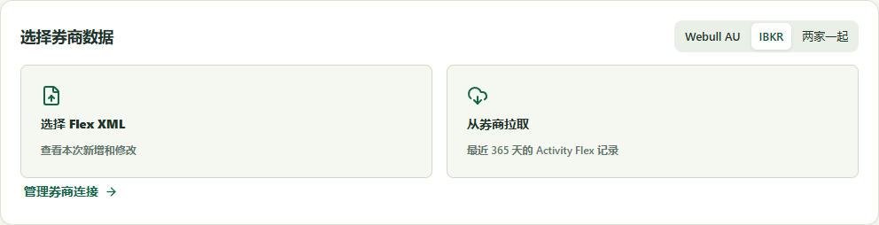

# 把一个 IBKR 账户接入 Stock Portfolio

这份指南适用于 Windows 桌面版 1.3.2。你需要能登录 IBKR 客户门户。完成后，你可以把这个账户的交易预览并导入自己的本地账本。

**如果你在 IBKR 有多个账户**，先选一个来走完整个流程。当前版保存一组 IBKR 在线连接设置；要为其他账户导入历史记录，可以给每个账户建立独立的本地账户，分别导入各自的 Flex XML 文件。直接替换现有 Query ID 会改变下一次在线拉取的来源。

## 1. 在电脑上建好接收记录的账户

首次打开 Stock Portfolio，如果没有旧账本，点欢迎页底部的 **建立空白账本**。已有正式账本就直接打开。进入 **数据与设置 → 账本与备份**，找到 **账户**。在「新账户名称」里填一个你认得出的名称，例如「IBKR · 长期账户」，选择该账户的基础币种，点 **创建账户**。已有对应本地账户可以直接用。创建成功后，名称会出现在账户列表里。

## 2. 在 IBKR 客户门户新建这一个账户的报表

用浏览器登录 IBKR，打开 **Performance & Reports → Flex Queries**。如果页面弹出账户选择器，只选这次要接入的账户。在 **Activity Flex Query** 区域点右上角的 **＋**，给报表起一个能区分账户的名字，例如「Portfolio 长期账户」。[IBKR 官方图解，第 1–4 步](https://www.ibkrguides.com/clientportal/performanceandstatements/activityflex.htm)

## 3. 选择报表内容，保存 Query ID

- 在 **Sections** 添加 **Trades**，勾选成交明细 **Executions** 及其全部字段。若要导入股息、入金等资金流水，加入 **Cash Transactions**。为读到账户币种、现金、持仓和净值，加入 **Account Information、Cash Report、Open Positions、Change in NAV**。逐项保存所选字段。日期格式选用年月日顺序，例如 **yyyyMMdd**。
- 在 **Delivery Configuration** 核对只包含目标账户，格式选 **XML**。第一次需要较长历史时，可以选 **Last 365 Calendar Days**。点 **Continue** 检查，再点 **Create**。
- 回到 Flex Queries，查看刚创建的查询，记下它的 **Query ID**。这是这份报表的编号。[IBKR 官方图解，第 5–10 步](https://www.ibkrguides.com/clientportal/performanceandstatements/activityflex.htm) · [IBKR 对 Query ID 的说明](https://www.ibkrguides.com/clientportal/performanceandstatements/flex3.htm)

## 4. 在 IBKR 取得 Flex Token

在同一页找到 **Flex Web Service Configuration**，点齿轮。首次使用时启用服务，按页面提示保存，复制 **Current Token**。如果服务已经启用，直接使用有效的当前 Token；生成新 Token 会使旧 Token 失效。[IBKR 官方开关与 Token 位置图](https://www.ibkrguides.com/clientportal/performanceandstatements/flex-web-service.htm)

## 5. 回到 Stock Portfolio，填写两项信息

打开 **数据与设置 → 券商与行情连接**，找到 **Interactive Brokers · Activity Flex**。把第 3 步的编号填进 **Flex Query ID**，把第 4 步的凭据填进 **Flex Token**，点 **保存 IBKR 设置**。看到保存提示后，继续用一次拉取来验证。

## 6. 核对账户，拉取并确认

打开 **导入与对账 → 导入与同步**，选择 **IBKR**。在「账本账户」里核对第 1 步的名称，再点 **从券商拉取**。预览里检查日期、代码和数量；内容正确才点预览中的确认按钮。导入完成后，在 **交易流水** 选择同一个账本账户，找一笔自己认识的记录。

**遇到问题时**，先看提示属于哪一步。凭据被拒绝时，检查 Query ID 是否来自目标查询，以及 Token 是否有效。提示包含多个账户时，回 IBKR 把查询范围改为一个账户。显示「没有新变化」时，核对账户、报表期间和已有流水；已经导入的记录可以没有新增。若要导入另一账户的文件，在 IBKR 运行该账户的查询并下载 XML，回到本页切换到对应本地账户，再点 **选择 Flex XML**。
