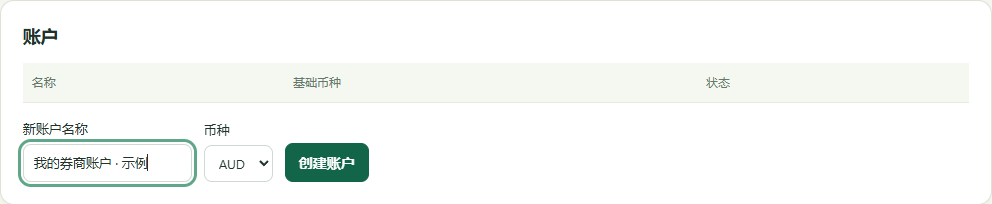
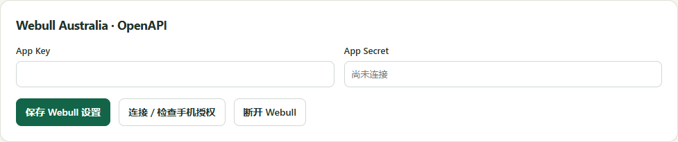
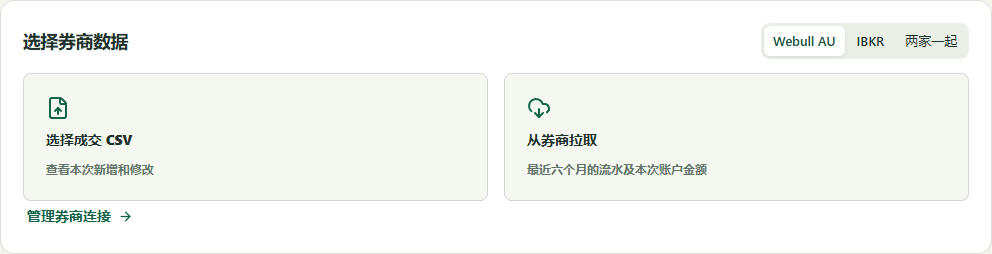

# 把一个 Webull Australia 账户接入 Stock Portfolio

这份指南适用于 Windows 桌面版 1.3.2 和 Webull **澳大利亚**个人账户。准备好能登录 Webull 的浏览器，以及装有 Webull App、能收到验证码的手机。已经取得 App Key 和 App Secret 的用户可以从第 4 步继续。

**如果你在 Webull 有多个账户**，开始前先确认本次要接入的账户名称或尾号。当前版保留一个选中的 Webull 在线账户，切换它会改变下次拉取的来源。每次拉取前，都要核对券商账户和接收记录的本地账户。

## 1. 在 Stock Portfolio 建立本地账户

首次打开时，如果没有旧账本，点欢迎页底部的 **建立空白账本**。已有正式账本就直接打开。进入 **数据与设置 → 账本与备份**，在「账户」里填入容易辨认的名称，例如「Webull · 个人账户」，选择基础币种，点 **创建账户**。已有对应账户可以直接用。名称出现在列表后，记住它，首次导入时还要选一次。

## 2. 在 Webull 澳洲网站申请 OpenAPI

在电脑浏览器打开 Webull Australia 的 OpenAPI 页面，点 **Apply for API Service**，使用持有该券商账户的身份登录。进入开发者工具；若没有自动进入，从头像菜单选 **Developer Tool**。打开 **API Management → My Application**，提交个人 API 服务申请。已通过审批则直接进行下一步。[Webull 澳洲申请入口](https://www.webull.com.au/open-api) · [官网申请页面图解](https://developer.webull.com.au/apis/docs/authentication/individual-application/#api-application)

**看到正在审核时可以先停在这里。** 审批结果会发到开户登记邮箱，也可以回到 **My Application** 查询。收到通过通知后再生成密钥。

## 3. 注册应用，生成 App Key 与 App Secret

仍在开发者工具里，打开 **API Management → API Keys Management**，注册一个应用。应用名称可填「Stock Portfolio」。注册完成后点 **Generate Key**，在 Webull 官方页面按提示完成短信和交易密码验证。生成后，妥善保存分别标为 **App Key** 和 **App Secret** 的两项值。请仅在 Webull 官方界面输入短信验证码和交易密码。[官网注册与生成密钥图解](https://developer.webull.com.au/apis/docs/authentication/individual-application/#register-an-api-application)

## 4. 回到 Stock Portfolio，发起连接

打开 **数据与设置 → 券商与行情连接 → Webull Australia · OpenAPI**。把两项值填进同名输入框，点 **保存 Webull 设置**。看到保存提示后，点旁边的 **连接 / 检查手机授权**。如果应用已经显示「已连接」和券商账户列表，直接到第 6 步。

## 5. 打开手机批准本次授权，再回电脑检查

若电脑提示等待手机授权，打开 **Webull 手机 App**。点授权通知；找不到推送时，依次进入 **Menu → Messages → OpenAPI Notifications**，打开最新一条消息，点 **Check Now**，输入短信验证码并点 **Confirm**。回到电脑，再点一次 **连接 / 检查手机授权**。看到「已连接」和券商账户列表后继续。若验证已过期，重新发起连接，并使用最新的通知。[Webull 澳洲官方手机验证步骤](https://developer.webull.com.au/apis/docs/authentication/token/#step-2-verify-in-the-webull-app)

## 6. 选中券商账户，再核对入账账户

先在连接面板的 **Webull 券商账户** 下拉列表核对账号，只选本次要读取的那个。再打开 **导入与对账 → 导入与同步**，选择 **Webull AU**，将「账本账户」选为第 1 步建立的本地账户。前者决定从哪里读取，后者决定写到哪里。

## 7. 拉取数据，确认第一笔记录

点 **从券商拉取**。在预览里核对一笔熟悉交易的日期、代码和数量，正确后点确认。随后在 **交易流水** 中选择相同的本地账户查找这笔交易。当前界面提示在线拉取最近六个月的流水；如果显示「没有新变化」，先核对时间范围、账户和已有记录。需要更早的成交时，可以在同一页点 **选择成交 CSV**，预览后再入账。

